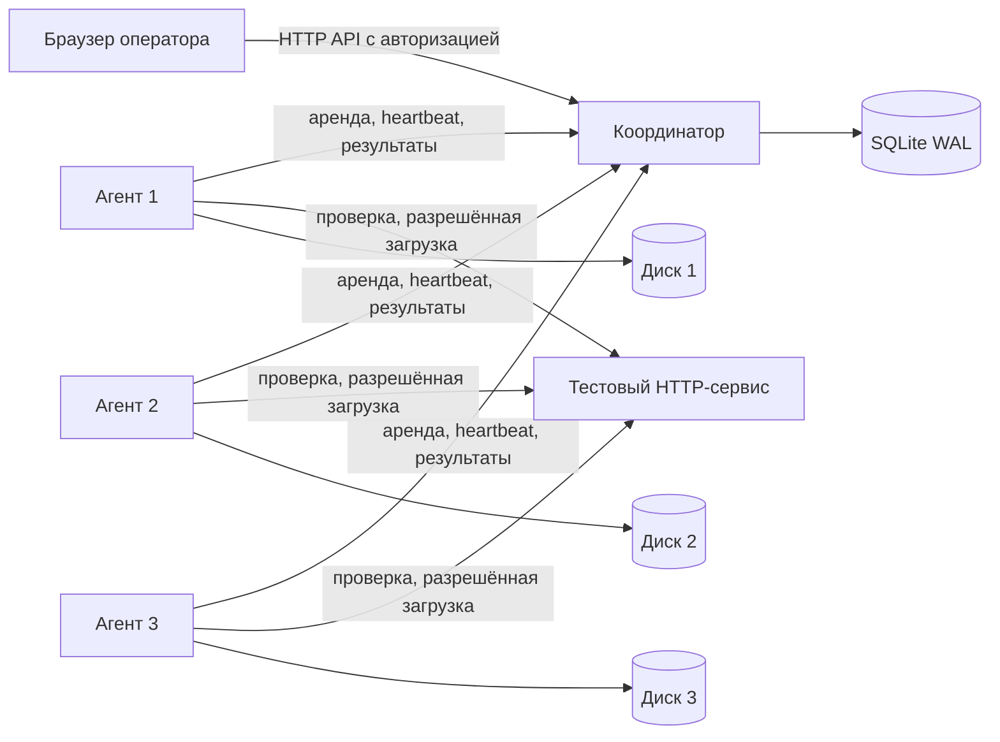
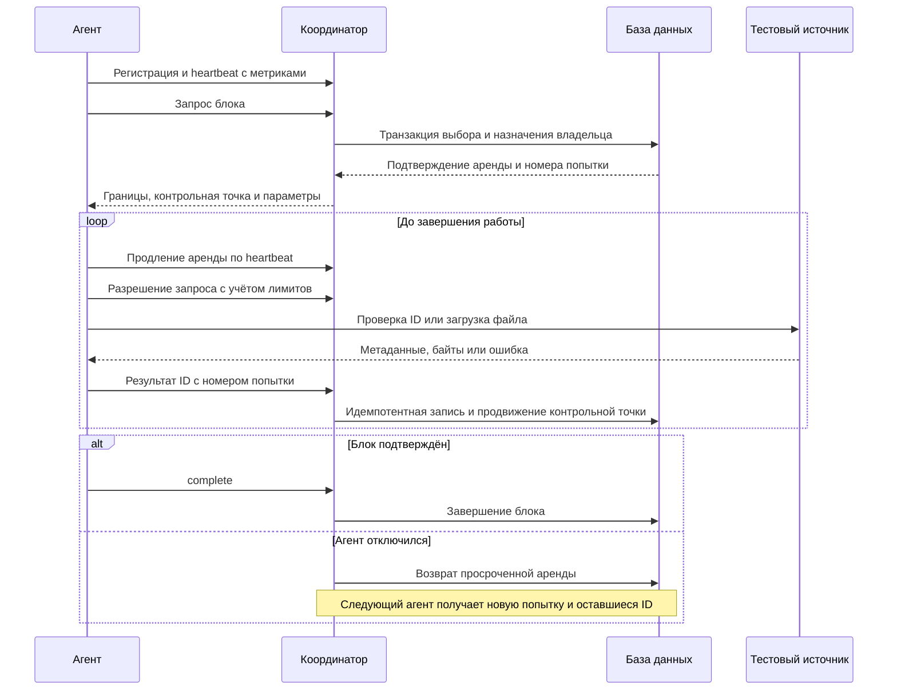
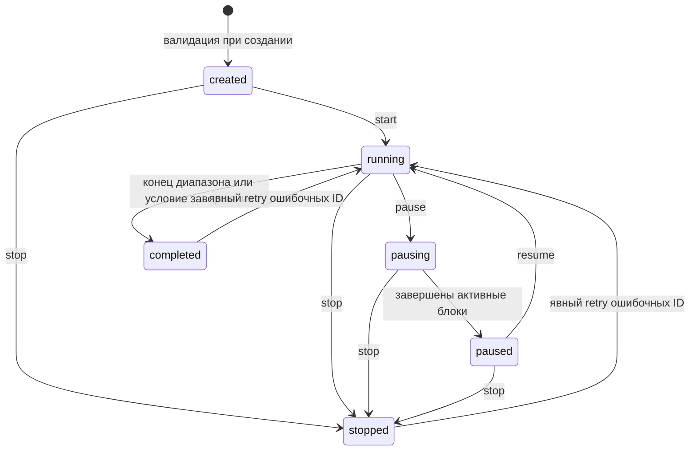

# Архитектура лабораторного стенда

Цель стенда — обработать заданный диапазон на нескольких узлах и сохранить подтверждённые результаты при потере узла или перезапуске координатора. Интерфейс и управляющее API обслуживает один процесс. Каждый агент имеет собственный каталог файлов, имя и ключ. При тестировании источником выступает управляемый HTTP-сервис.

## Компоненты

## Выдача блока и восстановление

## Состояния задания

Проверка конфигурации происходит до сохранения задания. Остановка аннулирует текущие аренды транзакционно. Ошибка отдельного материала сохраняется в результате этого ID. Завершённое задание может содержать ошибочные элементы.

## Модель и гарантии

Миграция `migrations/001.sql` создаёт таблицы пользователей и ролей, узлов и их метрик, заданий и выбранных для них узлов, блоков, результатов ID, метаданных, загрузок, файлов, событий, аудита и ограничителей частоты. При запуске `storage.initialize` применяет ещё не выполненные миграции в транзакции. Временные поля БД используют секунды Unix. Даты в файлах метаданных содержат смещение UTC.

Каждый блок относится к одному заданию. Границы включительны. Открытый диапазон расширяется по запросу свободного агента. Обработка допускает повторную доставку. При возврате старой попытки координатор сверяет ID владельца, номер попытки и срок аренды. Уникальная пара `(job_id, external_id)` защищает результат в БД. Контрольная точка указывает на первый неподтверждённый ID, даже когда потоки завершают операции в другом порядке.

Агент проверяет размер и SHA-256 файла перед атомарным переименованием. На своём диске он переиспользует уже проверенный файл и может докачать временный файл по HTTP Range. На другом узле без доступа к этому диску оставшиеся данные придётся скачать заново. Подтверждение результата в SQLite и публикация файла на удалённом диске — две отдельные операции. Авария между ними может оставить неучтённую физическую копию на выключенном узле. В БД может быть только один подтверждённый результат для пары «задание, ID».

## Владельцы

| Участник | Ответственность |
|---|---|
| Илья П. | Архитектура, миграции, контракты, интеграция |
| Полина | Координатор, управление заданиями и узлами, авторизация API |
| Гоша | Агент, загрузка, контроль целостности и восстановление |
| Дмитрий | Веб-панель, управление и мониторинг |
| Илья Б. | Стенд, испытания, отчёт и воспроизведение отказа |
